# 🎨 Awesome Generative AI Media Generation 🚀

**A comprehensive, curated directory of SaaS platforms, open-source diffusion models, local inference engines, node-based pipelines, and creative workflows for text-to-image, video, audio, and 3D generation.**

  
  
  
  
  
  

---

*Explore state-of-the-art Generative AI media synthesis tools across Stable Diffusion, FLUX.1, Midjourney, ComfyUI, Runway, Fooocus, and modern multimodal generative pipelines.*

## 📑 Table of Contents

- [🌐 Overview & Highlights](#-overview--highlights)
- [📊 Sector Overview & Market Dynamics](#-sector-overview--market-dynamics)
- [☁️ SaaS & Hosted Platforms](#️-saas--hosted-platforms)
- [💻 Open-Source GitHub Projects & Self-Hosted Workflows](#-open-source-github-projects--self-hosted-workflows)
- [🖥️ Hardware Requirements & Deployment Best Practices](#️-hardware-requirements--deployment-best-practices)
- [🤝 How to Contribute](#-how-to-contribute)
- [⚠️ Disclaimer & Ethical AI Considerations](#️-disclaimer--ethical-ai-considerations)
- [⭐ Star History](#-star-history)
- [💖 Support](#-support)
- [📜 License](#-license)

---

## 🌐 Overview & Highlights

Generative AI media generation has transformed creative industries, digital design, game development, VFX, and advertising. This repository indexes the entire generative media stack, bridging high-throughput commercial SaaS APIs and fully sovereign, privacy-preserving, self-hosted open-source diffusion architectures.

### 🔍 Key Modalities Covered
- **🎨 Text-to-Image & Image-to-Image**: Latent Diffusion Models (LDM), Rectified Flow Transformers (FLUX), SDXL, ControlNet conditioning, and high-fidelity upscaling.
- **🎬 Text-to-Video & Video-to-Video**: Diffusion Transformers (DiT), spatial-temporal attention, camera trajectory motion brushes, and video inpainting.
- **🎵 Text-to-Audio & Speech**: Autoregressive audio tokens, neural audio compression (EnCodec), multilingual speech synthesis, and acoustic ambient effects.
- **⚡ Modular Node Engines**: Infinite-canvas visual programming, reproducible JSON execution graphs, and headless local REST API orchestration.

---

## 📊 Sector Overview & Market Dynamics

The global generative AI media and entertainment market was valued at **$2.1 Billion in 2023** and is projected to surpass **$36.8 Billion by 2032**, expanding at a compound annual growth rate (**CAGR) of 37.4%**, driven by exponential breakthroughs in multimodal foundation models and creative workflow automation.

The sector exhibits a **moderately fragmented "barbell" market concentration structure**: high-compute foundational layers (OpenAI, Adobe, Google) exhibit oligopolistic characteristics due to multi-billion-dollar compute training moats, while the application and self-hosted tooling layers remain vibrant and decentralized. A massive influx of open-weight models (FLUX.1, Stable Diffusion) and community node ecosystems (ComfyUI) effectively counters "winner-take-all" dynamics, empowering studios to retain local hardware sovereignty, bypass cloud vendor lock-in, and customize local pipelines freely.

---

## ☁️ SaaS & Hosted Platforms

The following curated table details the leading commercial SaaS platforms for generative media generation. Products are sorted in **descending order by company size** (market capitalization or latest enterprise valuation).

| 🏢 Platform & Provider | 📈 Company Size (Valuation / Revenue) | 💳 Starting Tier Price | 🎁 Free Tier Limits | 🎯 Core Strengths & Modalities |
| :--- | :--- | :--- | :--- | :--- |
| **[Adobe Firefly](https://www.adobe.com/products/firefly.html)** *(Adobe Inc.)* | **$215 Billion** Market Cap *(~$21.4B Annual Revenue)* | **$4.99 / month** *(Firefly Standard plan with 100 generative credits/mo; also included in Creative Cloud plans from $9.99/mo)* | **25 generative credits / month** free forever (resets monthly with a free Adobe ID; watermarked, non-commercial on free plan) | Enterprise-grade, commercially safe text-to-image, vector generation, and generative fill natively built into Photoshop and Illustrator. |
| **[OpenAI (DALL·E 3 / GPT-4o)](https://openai.com/dall-e-3)** *(OpenAI)* | **$157 Billion** Valuation *(~$3.7B+ ARR)* | **$20.00 / month** *(ChatGPT Plus subscription) or pay-as-you-go API at **$0.040 / image** (Standard 1024×1024) and **$0.080 / image** (HD)* | **2 to 3 images / day** rolling limit on free ChatGPT accounts; new API developers receive **$5 in free credits** valid for 3 months upon account verification | Industry-leading natural language prompt adherence, complex composition logic, text typography in artwork, and conversational iterative editing. |
| **[Leonardo.ai](https://leonardo.ai/)** *(Canva)* | **$32 Billion** Canva Valuation *(Acquired Leonardo.ai for $320M; Canva ARR >$2.5B)* | **$10.00 / month** *(Apprentice plan billed annually at $10/mo, or $12/mo billed monthly; includes 8,500 fast tokens/month)* | **150 fast tokens / day** free forever (resets every 24 hours; allows ~75 image generations per day at standard resolution) | Fine-tuned gaming asset styles, custom LoRA model training, multi-canvas infinite board editing, and motion animation tools. |
| **[Midjourney](https://www.midjourney.com/)** *(Midjourney, Inc.)* | **~$10 Billion** Est. Valuation *(~$300 Million ARR; Bootstrapped & Profitable)* | **$10.00 / month** *(Basic Plan with 3.3 hours Fast GPU time/month, yielding ~200 image generations + web/Discord access)* | **No permanent free tier** (standard free trials suspended due to demand; periodic promotional 25-generation free trials run during major version rollouts) | Aesthetic gold standard for hyper-realistic lighting, artistic stylization, cinematic camera controls, character consistency, and community inspiration feed. |
| **[Runway (Gen-2 / Gen-3 Alpha)](https://runwayml.com/)** *(Runway AI, Inc.)* | **$4.0 Billion** Valuation *(Tier-1 Generative Video Pioneer)* | **$12.00 / month** *(Standard plan billed annually at $12/mo, or $15/mo monthly; includes 625 monthly generation credits)* | **125 one-time free credits** upon initial sign-up (non-renewing; yields ~25 image generations or ~3 video generations) + up to 3 video projects | Hollywood-caliber text-to-video, image-to-video, director motion brushes, camera trajectory choreography, and real-time video inpainting. |
| **[Stability AI Developer Platform](https://platform.stability.ai/)** *(Stability AI)* | **$1.0 Billion** Valuation *(Restructured 2024; $170M+ total funding raised)* | **$10.00** minimum prepaid credit package *(SD 3.5 Large at 6.5 credits/image, approx. **$0.065 / image**); Commercial Membership starts at **$20.00 / month*** | **25 free credits** upon new account sign-up on the Developer Platform (one-time non-expiring grant for API exploration) | Direct developer API gateway for Stable Diffusion 3.5, SDXL, Stable Video Diffusion, Stable Audio, and fast image upscaling. |
| **[Pika](https://pika.art/)** *(Pika Technologies)* | **$470 Million** Valuation *(Leading Generative Motion Studio)* | **$8.00 / month** *(Standard plan billed annually at $8/mo, or $10/mo monthly; includes 700 monthly credits)* | **250 initial credits** upon sign-up + **30 recurring bonus credits / day** free forever (standard queue speed, video watermarking) | Intuitive short-form video generation, lip-syncing, physics-defying effects (crush, melt, explode), and flexible aspect ratio re-framing. |

---

## 💻 Open-Source GitHub Projects & Self-Hosted Workflows

Open-source and self-hosted generative media tools grant creators complete sovereignty over neural weights, privacy compliance, and infinite procedural extensibility. 

The repositories below are **strictly ranked in descending order by GitHub stargazers count**. Each badge links directly to that repository's stargazers community page.

---

### 1. 🖼️ [AUTOMATIC1111 / stable-diffusion-webui](https://github.com/AUTOMATIC1111/stable-diffusion-webui)

- **License**: GNU AGPL-3.0
- **Modality**: Text-to-Image, Image-to-Image, Inpainting, Upscaling
- **Description**: The legendary web interface that catalyzed open-source AI art. Features an expansive Gradio GUI, seamless LoRA and checkpoint switching, textual inversions, Deforum video synthesis, and thousands of community extensions.
- **Best For**: Creators wanting an all-in-one browser interface packed with proven community extensions and scripts.

---

### 2. ⚡ [Comfy-Org / ComfyUI](https://github.com/Comfy-Org/ComfyUI)

- **License**: GNU GPL-3.0
- **Modality**: Multimodal (Image, Video, Audio, 3D) Node Pipeline
- **Description**: The undisputed production industry standard for diffusion workflows. Represents each step of the diffusion execution graph as a node — decoupling base checkpoints, LoRA blending, CLIP guidance, ControlNet conditioners, and latent upscaling into reproducible JSON schemas.
- **Best For**: Power users, VFX studios, and developers requiring deterministic execution graphs, ultra-low VRAM memory optimization, and headless API batch automation.

---

### 3. 🔬 [CompVis / stable-diffusion](https://github.com/CompVis/stable-diffusion)

- **License**: CreativeML Open RAIL-M
- **Modality**: Latent Diffusion Foundation Models
- **Description**: The historic reference implementation of Latent Diffusion Models (LDM) developed by the Machine Vision and Learning Group at LMU Munich in collaboration with Runway and Stability AI.
- **Best For**: Academic researchers and machine learning engineers studying foundational latent diffusion mathematics and sampling architectures.

---

### 4. 🎯 [lllyasviel / Fooocus](https://github.com/lllyasviel/Fooocus)

- **License**: GNU GPL-3.0
- **Modality**: One-Click Text-to-Image & Image-to-Image
- **Description**: An offline, zero-configuration image generator engineered to bring Midjourney-style prompt ease to SDXL and local diffusion models. Features automatic negative prompting, dynamic samplers, intelligent face-swap, and cinematic prompt expansion out of the box.
- **Best For**: Beginners and illustrators seeking instant, photorealistic results without configuring complex latent parameters or CUDA dependencies.

---

### 5. 🔊 [suno-ai / bark](https://github.com/suno-ai/bark)

- **License**: MIT
- **Modality**: Text-to-Audio, Multilingual Speech & Music
- **Description**: Transformer-based text-to-audio foundation model developed by Suno. Generates expressive speech with nonverbal vocalizations (laughter, sighs, hesitation), realistic background ambiance, and musical melodies.
- **Best For**: Game developers, animators, and podcast producers creating dynamic character voiceovers and audio environments.

---

### 6. 📚 [huggingface / diffusers](https://github.com/huggingface/diffusers)

- **License**: Apache-2.0
- **Modality**: Multimodal Diffusion Library (PyTorch)
- **Description**: Hugging Face's foundational Python library for state-of-the-art diffusion pipelines. Supports FLUX.1, SDXL, Stable Video Diffusion, Kandinsky, and audio models with unified tensor scheduling, quantization, and LoRA loading.
- **Best For**: Machine learning engineers building custom production microservices, REST endpoints, and fine-tuning scripts.

---

### 7. 🎛️ [lllyasviel / ControlNet](https://github.com/lllyasviel/ControlNet)

- **License**: Apache-2.0
- **Modality**: Spatial Condition Conditioning
- **Description**: The revolutionary neural architecture that brought deterministic geometric control to diffusion models. Condition generation on human pose wireframes (OpenPose), Canny edge contours, depth maps, surface normals, and segmentations.
- **Best For**: Professional illustrators and concept artists needing precise character poses, architecture silhouettes, and compositional alignment.

---

### 8. 🌐 [Anil-matcha / Open-Generative-AI](https://github.com/Anil-matcha/Open-Generative-AI)

- **License**: MIT
- **Modality**: 600+ Model Image & Video Studio UI
- **Description**: A self-hosted, unrestricted creative studio connecting 50+ image models (Flux, SDXL, Midjourney styles) and 40+ video generators (Kling, Sora, Veo, Wan) with lip-syncing capabilities in an all-in-one web portal.
- **Best For**: Creative teams wanting a single unified dashboard across dozens of commercial and open model endpoints.

---

### 9. 🎭 [facefusion / facefusion](https://github.com/facefusion/facefusion)

- **License**: MIT
- **Modality**: Face Swapping & Enhancement Engine
- **Description**: Next-generation deepfake and video face-swapping software with hardware-accelerated rendering, real-time live preview, face lip-syncing, frame restoration, and color grading.
- **Best For**: Film post-production, digital avatars, and real-time streaming face transformation.

---

### 10. 🎨 [invoke-ai / InvokeAI](https://github.com/invoke-ai/InvokeAI)

- **License**: Apache-2.0
- **Modality**: Professional Creative Studio & Infinite Canvas
- **Description**: Studio-grade visual creation suite featuring an infinite unified canvas for seamless inpainting, outpainting, and multi-layer composition. Delivers the polish of Photoshop with dual workflow tabs offering optional ComfyUI-style node graphs.
- **Best For**: Concept artists, art directors, and creative agencies wanting studio stability, asset management, and native macOS/Windows installers.

---

### 11. 🔮 [black-forest-labs / flux](https://github.com/black-forest-labs/flux)

- **License**: Apache-2.0 (Schnell) / Non-Commercial (Dev)
- **Modality**: 12B Rectified Flow Transformer Models
- **Description**: Official open-weight repository from Black Forest Labs (created by the original Stable Diffusion inventors). Includes FLUX.1 [schnell] for ultra-fast 4-step generation and FLUX.1 [dev] for benchmark-topping anatomical realism and text generation.
- **Best For**: High-end photorealism, complex multi-character anatomy, typography in images, and fine-art generation.

---

### 12. 🎼 [facebookresearch / audiocraft](https://github.com/facebookresearch/audiocraft)

- **License**: MIT
- **Modality**: Generative Music & Acoustic Sound Effects
- **Description**: Meta AI's comprehensive PyTorch suite for generative audio. Houses MusicGen (high-fidelity stereo musical synthesis from text descriptions) and AudioGen (environmental sound effects), powered by EnCodec neural compression.
- **Best For**: Game designers, film sound engineers, and musicians generating royalty-free procedural audio stems and Foley sound effects.

---

### 13. 🍏 [divamgupta / diffusionbee-stable-diffusion-ui](https://github.com/divamgupta/diffusionbee-stable-diffusion-ui)

- **License**: GNU GPL-3.0
- **Modality**: Native macOS Offline Generator
- **Description**: The simplest offline application to run Stable Diffusion on Apple Silicon (M1, M2, M3, M4 Macs). Requires zero terminal setup or Python knowledge, running completely offline with Metal Performance Shaders (MPS).
- **Best For**: Mac users, designers, and privacy-conscious artists seeking a 100% self-contained native macOS DMG application.

---

### 14. 🎬 [zai-org / CogVideo](https://github.com/zai-org/CogVideo)

- **License**: Apache-2.0
- **Modality**: Text-to-Video Diffusion Transformer (DiT)
- **Description**: Advanced open-source video generation framework (CogVideoX) developed by THUDM / Zhipu AI. Generates fluid, temporally coherent video clips up to 4K resolution using 3D variational autoencoders and expert transformer backbones.
- **Best For**: AI cinematographers and video creators demanding state-of-the-art open-source temporal consistency in video synthesis.

---

### 15. 🖌️ [Acly / krita-ai-diffusion](https://github.com/Acly/krita-ai-diffusion)

- **License**: GNU GPL-3.0
- **Modality**: Digital Painting & Live Inpainting Plugin
- **Description**: Transform the open-source Krita digital painting software into a real-time generative canvas. Features live canvas brush generation, inpainting, outpainting, and ControlNet posing connected seamlessly to a local ComfyUI server.
- **Best For**: Digital painters and illustrators who want generative AI directly integrated into their digital drawing tablet workflow.

---

### 16. 🚀 [easydiffusion / easydiffusion](https://github.com/easydiffusion/easydiffusion)

- **License**: MIT
- **Modality**: 1-Click Multi-Platform Web UI
- **Description**: Zero-hassle, single-click installer for Stable Diffusion across Windows, Linux, and macOS. Provides automatic model downloads, GPU memory optimizations, background task queues, and clean browser interfaces.
- **Best For**: Users who want a reliable local installation without encountering Torch, CUDA, or Python environment version conflicts.

---

### 17. 🤖 [11cafe / jaaz](https://github.com/11cafe/jaaz)

- **License**: Apache-2.0
- **Modality**: Agentic Multimodal Design Canvas
- **Description**: Open-source multimodal AI design agent and local Canva / Manus alternative. Delivers interactive object insertion, multi-character coherence, scene storyboarding, and local LLM routing through Ollama and ComfyUI.
- **Best For**: Marketing designers and developers creating multi-step visual branding campaigns using locally autonomous AI agents.

---

### 18. 🌀 [deforum / deforum-stable-diffusion](https://github.com/deforum/deforum-stable-diffusion)

- **License**: MIT
- **Modality**: 2D/3D Algorithmic Animation Engine
- **Description**: Community-driven animation framework that turns Stable Diffusion into a psychedelic, camera-driven video synthesizer. Controls 3D camera pan, tilt, zoom, and audio-reactive frequency keyframing.
- **Best For**: Music video producers, VJs, and motion graphics animators creating audio-reactive generative visuals.

---

### 19. 📱 [drawthingsai / draw-things-community](https://github.com/drawthingsai/draw-things-community)

- **License**: Community / App Store
- **Modality**: On-Device Apple Silicon / Mobile Diffusion
- **Description**: The community and extensions ecosystem for Draw Things — the hyper-optimized 8-bit quantized on-device diffusion app for iPhone, iPad, and Apple Silicon Macs with ComfyUI gRPC bridging.
- **Best For**: Mobile creators and iPad artists seeking ultra-fast local generation without internet connectivity.

---

## 🖥️ Hardware Requirements & Deployment Best Practices

Running generative AI models locally requires matching model architectures to your hardware profile:

| Model Architecture | Minimum VRAM | Recommended VRAM | Recommended GPU | Key Optimization Techniques |
| :--- | :--- | :--- | :--- | :--- |
| **Stable Diffusion 1.5** | 4 GB | 8 GB | NVIDIA RTX 3060 / Apple M1 | `--medvram`, xFormers, SD-PA |
| **SDXL 1.0** | 8 GB | 12 GB | NVIDIA RTX 4070 / Apple M2 (16GB) | fp16, PyTorch 2.x SDPA, model offload |
| **FLUX.1 [schnell]** | 12 GB | 16 GB | NVIDIA RTX 4080 / Apple M3 (24GB) | 8-bit / 4-bit NF4 quantization, CPU offload |
| **FLUX.1 [dev]** | 16 GB | 24 GB | NVIDIA RTX 3090 / 4090 / A5000 | GGUF / FP8 checkpointing, flash attention |
| **CogVideoX (Video)** | 16 GB | 24 GB+ | NVIDIA RTX 4090 / A100 | Sequential CPU offloading, DeepSpeed ZeRO |

---

## 🤝 How to Contribute

Contributions from the generative AI community are warmly welcome! To propose new SaaS platforms or open-source repositories:

1. 🍴 **Fork** this repository.
2. 🌿 **Create a new branch**: `git checkout -b feature/add-new-tool`.
3. 📝 **Add your entry** under the appropriate section following the existing format:
   - Provide verified starting prices and free tier limits for SaaS products.
   - For open-source tools, include the repository URL, description, and official Stars_Badge linking to `/stargazers`.
4. 📬 **Submit a Pull Request** with a concise description of why the tool is significant to the generative media ecosystem.

---

## ⚠️ Disclaimer & Ethical AI Considerations

- **Licensing Awareness**: Downloadable neural model weights do not always equal OSI-approved open source. Many checkpoints (e.g., FLUX.1 [dev], SD 3.5) carry non-commercial or source-available clauses. Always inspect the model card on Hugging Face or Civitai before commercial deployment.
- **Data Privacy**: Running models locally via ComfyUI, InvokeAI, or Fooocus guarantees that prompts and generated imagery never leave your physical workstation.
- **Responsible Synthesis**: Please adhere to responsible AI generation ethics. Do not use generative tooling to produce non-consensual imagery, deepfakes intended to deceive, or harmful content.

---

## ⭐ Star History

---

## 💖 Support

Thank you for exploring and bookmarking **Awesome Generative AI Media Generation**! 🌟

If this curated repository saved you hours of research or empowered your generative workflow, please consider showing your support:
- ⭐ **Star this repository** to help other creators and researchers discover it.
- 🍴 **Fork and share** it with your creative community and colleagues.
- ☕ **Sponsor or buy a coffee** to help maintain and regularly update this directory:

  

Your generous encouragement keeps this directory independent, accurate, and up-to-date! 🚀

---

## 📜 License

This compilation is open-source and released under the **[MIT License](LICENSE)**.
